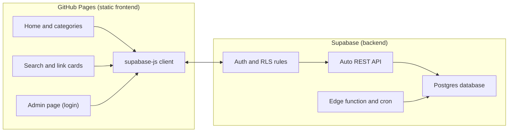
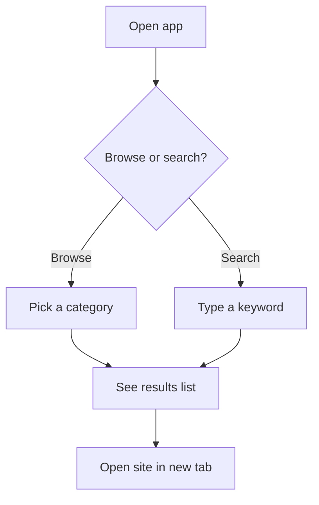
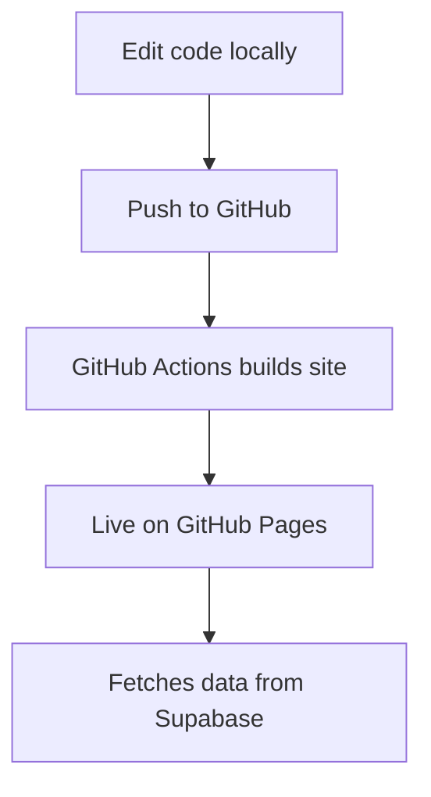
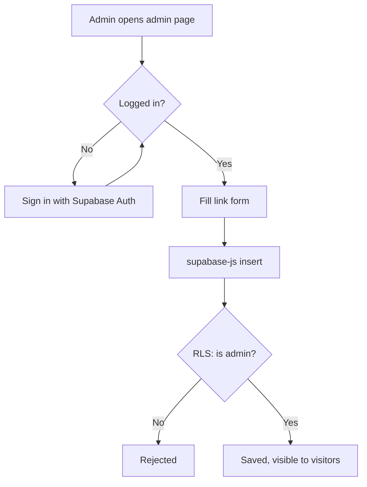
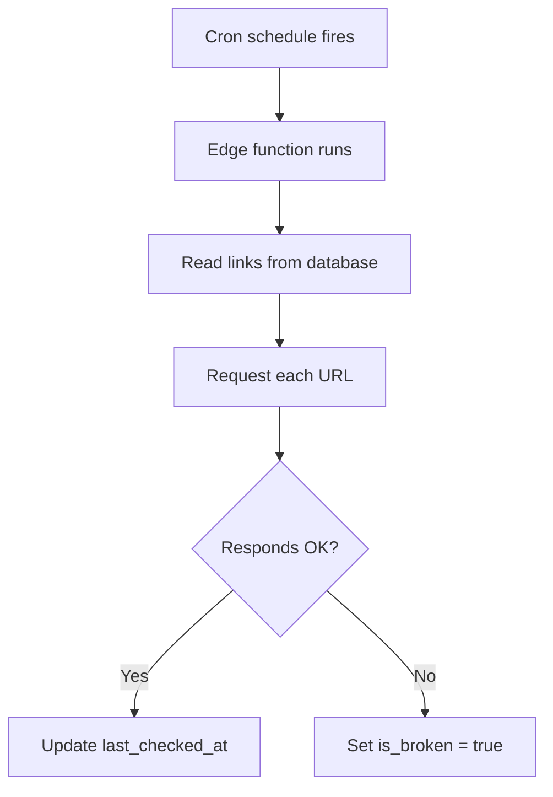

# Architecture

Site URL: `https://pievenus.github.io/yhmf/`

GitHub renders the Mermaid diagrams below directly.

## 1. Block diagram: system

Notes:
- Frontend is a React and Vite app built to static files (D12).
- There is no custom API server. Supabase exposes tables through its built-in REST API.
- RLS decides access: public can read approved links, only the admin can write.
- The edge function plus cron job checks URLs and flags dead links.

## 2. Flowchart: visitor journey

## 3. Flowchart: deploy and runtime

## 4. Flowchart: admin adds a link

## 5. Flowchart: dead link checker (later phase)

## Earlier version (superseded)

The first draft had a separate Links API and a separate search index in the backend. Both were removed once GitHub Pages and Supabase were chosen. See `docs/DECISIONS.md`.
